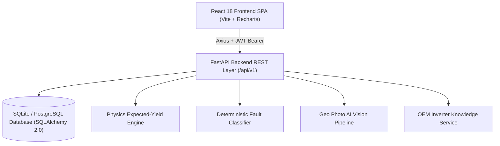

# SolarMind ☀️🧠

> **AI-Assisted Solar Monitoring & Fault Diagnosis Platform for Household On-Grid PV Systems**

SolarMind is an intelligent solar analytics and fault diagnostic platform tailored for residential single-string and distributed commercial solar PV installations. It pinpoints abnormal energy generation, isolates the probable physical or electrical root causes (such as partial shading, module soiling, inverter clipping, degradation, grid overvoltage, or open circuit trips), quantifies lost kilowatt-hours and financial deficits in ₹ INR, and generates actionable, safe maintenance work orders.

---

## 🌟 Key Features

1. **Deterministic & Probabilistic Fault Diagnosis**:
   - High Plane-of-Array (POA) irradiance vs low active AC output analysis.
   - Diurnal string current attenuation detection (partial shading vs heavy dust).
   - Inverter thermal clipping & MPPT saturation detection.
   - Grid line overvoltage trip tracking & anti-islanding detection.
   - Distinguishes physical facts from algorithmic inferences with transparent confidence metrics.
2. **Manufacturer-Aware Inverter Fault Knowledge**:
   - Verbatim OEM manual code definitions, manufacturer troubleshooting protocols, and electrical safety hazard warnings.
   - Manufacturer-aware fault catalogs (e.g. Deye SUN-(70-110)K-G03 series, Sungrow, SMA).
   - Graceful fallback for unmapped or unknown codes (`UNRESOLVED_UNKNOWN_CODE`).
3. **Energy & Financial Loss Estimation**:
   - Integrates irradiance, ambient temperature, installed capacity ($kW_p$), and local utility tariff rates (₹/kWh).
   - Separates confirmed historical energy losses from potential ongoing deficits.
4. **Geo Photo AI Image Inspection Pipeline**:
   - Multi-part binary image upload with MIME verification, magic bytes check, and PIL decoded pixel validation.
   - Pluggable computer vision pipeline (returns explicit `NOT_CONFIGURED` status when vision model weights are not configured, avoiding synthetic hallucinations).
   - Path traversal prevention and server-side UUID storage isolation.
5. **Maintenance & Field Work Order Lifecycle**:
   - One-click work order creation directly from diagnosed fault dossiers.
   - Full lifecycle management (`OPEN` ➔ `ASSIGNED` ➔ `IN_PROGRESS` ➔ `COMPLETED_PENDING_VERIFICATION` ➔ `RESOLVED`).
   - Post-repair generation recovery verification window.
6. **Role-Based Access Control (RBAC)**:
   - Built-in roles: `ADMIN`, `OPERATOR`, `TECHNICIAN`, `HOMEOWNER`.
   - Argon2 password hashing and JWT session tokens.
7. **Production Data Resilience**:
   - Zero-falsified data policy: missing or offline sensor telemetry renders `null` / `"--"` rather than fabricating zero generation.
   - Explicit demo toggle isolating mock fallback from live backend responses.

---

## 🏗️ Architecture



---

## 📋 Prerequisites

- **Node.js**: `v18.0.0` or higher (Node 20+ recommended)
- **Python**: `3.10`, `3.11`, `3.12`, `3.13`, or `3.14`
- **npm**: `v9.0.0` or higher
- **Git**

---

## ⚡ Installation & Setup Instructions

### 1. Clone Repository & Setup Environment
```bash
git clone https://github.com/DeepakKar17/SYNTECXHUB_CREDIT_CARD_FRAUD_DETECTION.git solarmind
cd solarmind
```

### 2. Backend Setup
```bash
cd backend

# Create and activate Python virtual environment
python -m venv .venv
# On Windows PowerShell:
.\.venv\Scripts\Activate.ps1
# On macOS / Linux:
source .venv/bin/activate

# Install Python dependencies
pip install -r requirements.txt

# Create local environment config
cp .env.example .env

# Run database migrations
alembic upgrade head
```

### 3. Frontend Setup
```bash
cd ../frontend

# Install dependencies
npm install

# Create local environment config
cp .env.example .env
```

---

## 🚀 Running the Application

### Start Backend API Server
```bash
cd backend
uvicorn app.main:app --reload --host 0.0.0.0 --port 8000
```
- **API Base URL**: `http://localhost:8000/api/v1`
- **Swagger Interactive API Docs**: `http://localhost:8000/docs`
- **ReDoc API Documentation**: `http://localhost:8000/redoc`
- **Health Check**: `http://localhost:8000/api/v1/health`
- **Readiness Check**: `http://localhost:8000/api/v1/readiness`

### Start Frontend Application
```bash
cd frontend
npm run dev
```
- **Web App**: `http://localhost:5173`

---

## 🔐 Environment Configuration

### Backend (`backend/.env`)
| Variable | Default / Description |
| :--- | :--- |
| `PROJECT_NAME` | `"SolarMind Backend"` |
| `ENVIRONMENT` | `development` (`production` enforces HTTPS cookies & disables debug docs) |
| `ALLOWED_ORIGINS` | `["http://localhost:5173","http://127.0.0.1:5173"]` (CORS whitelist) |
| `DATABASE_URL` | `sqlite:///./data/solarmind.db` |
| `SECRET_KEY` | Secret salt for JWT tokens and sessions |
| `MAX_PHOTO_SIZE_BYTES`| `10485760` (10 MB upload cap) |
| `UPLOAD_DIR` | `uploads/photos` |
| `VISION_MODEL_ENABLED`| `false` (Set `true` when PyTorch/ONNX vision model is attached) |

### Frontend (`frontend/.env`)
| Variable | Default / Description |
| :--- | :--- |
| `VITE_API_BASE_URL` | `http://127.0.0.1:8000` (FastAPI backend origin) |

---

## 💾 Database Setup, Seed Data & Migrations

```bash
cd backend

# Apply migrations
alembic upgrade head

# Database is auto-seeded on first run with demo plants, inverters, and initial admin:
# Email: admin@solarmind.io
# Password: SolarAdmin#2026!
```

---

## 🧪 Testing Instructions

### Run All Backend Tests (Pytest)
```bash
cd backend
python -m pytest -v
```
*Current test suite: **257 passing tests** covering authentication, physics engines, fault classifiers, photo upload security, database persistence, and the complete 12-step user journey.*

### Run All Frontend Tests (Vitest)
```bash
cd frontend
npm run test -- --run
```
*Current test suite: **217 passing tests** across 28 suites covering RTL component tests, state management, RBAC, and mocked API service clients.*

### Run Frontend Production Build & Linter
```bash
cd frontend
npm run lint
npm run build
npm run preview -- --port 5173
```

---

## 🔧 Troubleshooting

1. **CORS Errors**:
   - Ensure the frontend URL (`http://localhost:5173` or `http://127.0.0.1:5173`) is listed in `ALLOWED_ORIGINS` in `backend/.env`.
2. **Database Locked in SQLite**:
   - Ensure previous background processes are terminated or set `DATABASE_URL` to a PostgreSQL instance in production.
3. **Missing Module on Windows**:
   - Ensure virtual environment is activated before running tests: `.\.venv\Scripts\Activate.ps1`.

---

## ⚠️ Known Limitations

1. **Computer Vision Model Weights**:
   - The Geo Photo AI pipeline is structured with a pluggable interface; when no trained model weights file (`.onnx` / `.pt`) is configured, it reports explicit `NOT_CONFIGURED` status rather than fabricating detections.
2. **Single-String Inverters Focus**:
   - Analytical models prioritize single-MPPT residential systems; complex multi-MPPT central inverter string combiners require supplemental DC sub-string sensor data.

---

## 🗺️ Future Development Plan

- [ ] **Phase 5: Real Inverter Cloud Integrations** (Live bidirectional telemetry sync via Deye Cloud Open API, Sungrow iSolarCloud, and SolarEdge APIs).
- [ ] **Phase 6: Edge Vision Inference** (Deployment of quantized MobileNetV3 / YOLOv8 model for on-device panel crack & soiling segmentation).
- [ ] **Phase 7: Automated Utility Grid Meter Billing Reconciliation** (DISCOM net-meter export billing verification with automated tariff settlement audits).
