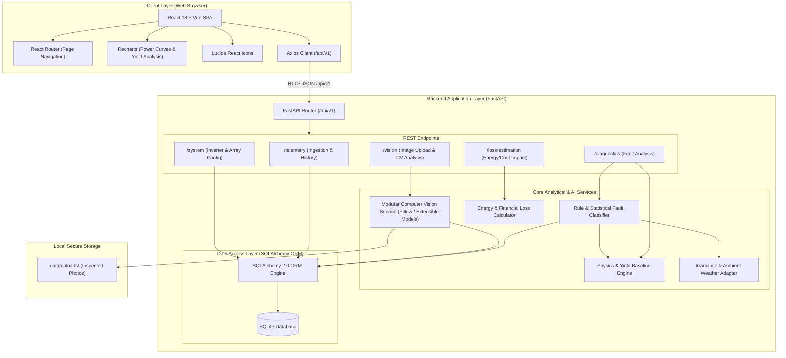
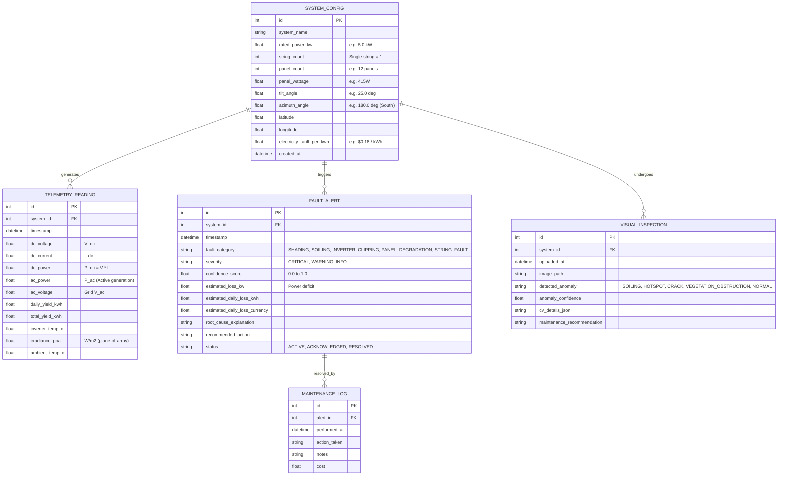
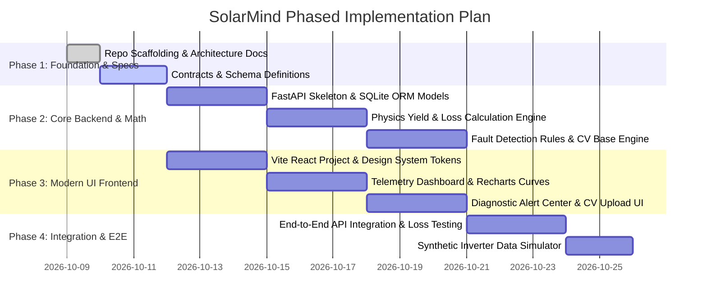

# SolarMind Architecture Document
**Version:** 1.0.0  
**Target:** Household Single-String Inverter On-Grid PV Systems  
**Status:** Approved Architectural Baseline  

---

## 1. Executive Summary & Project Objective

**SolarMind** is an intelligent solar monitoring, anomaly detection, and fault diagnosis platform designed specifically for household single-string on-grid photovoltaic (PV) installations (typically 3 kW – 10 kW residential systems).

### Key Problem
Household solar owners frequently suffer silent energy losses caused by partial shading, soiling, panel microcracks, degradation, string disconnections, or inverter clipping/faults without knowing the root cause, financial impact, or necessary corrective actions.

### Core Capabilities
1. **Real-time & Batch Telemetry Ingestion**: Ingests DC voltage, DC current, AC power, daily cumulative yield, grid voltage/frequency, and weather/irradiance metrics.
2. **Hybrid Anomaly Detection**: Combines deterministic physical PV yield models (clear-sky & POA irradiance baselines) with heuristic rules and statistical deviation detection.
3. **Computer Vision (CV) Inspection Interface**: Modular vision pipeline for diagnostic analysis of user-uploaded panel photos (hotspots, soiling, visible cracking, physical obstruction).
4. **Energy & Financial Loss Quantification**: Computes lost kWh and monetary loss based on local grid feed-in tariffs (FiT) / self-consumption rates.
5. **Actionable Maintenance Guidance**: Generates prioritized, step-by-step remediation advice for homeowners and technicians.

---

## 2. System Architecture & Communication Flow



---

## 3. Technology Stack & Module Responsibilities

| Layer / Domain | Technology | Responsibility |
| :--- | :--- | :--- |
| **Frontend Framework** | React 18, Vite, JavaScript (ESNext) | Interactive, responsive Single Page Application (SPA). |
| **Routing & State** | React Router v6, Context API / Hooks | Client-side navigation, telemetry streaming state, active alerts. |
| **Data Visualization** | Recharts | Dynamic daily yield curves, expected vs. actual power comparisons, loss breakdown charts. |
| **UI Aesthetics** | Vanilla CSS (CSS Modules & Custom Properties), Lucide React | High-contrast solar telemetry visual design, dark/light theme, glassmorphism cards, zero bloated utility frameworks. |
| **HTTP Client** | Axios | RESTful communication with backend under `/api/v1` with unified interceptors and error handlers. |
| **Backend Framework** | Python 3.10+, FastAPI, Uvicorn | High-throughput asynchronous REST API server with automatic OpenAPI documentation. |
| **Data Validation** | Pydantic v2 | Strict schema validation for incoming telemetry, image payloads, configuration, and API responses. |
| **Database & ORM** | SQLite 3 (Prototype), SQLAlchemy 2.0 | Persistent relational storage for inverter profiles, time-series telemetry snapshots, fault logs, and maintenance records. |
| **Image Processing** | Pillow (PIL), Modular CV Interface | Image pre-processing, EXIF extraction, color/contrast anomaly checks, thermal-gradient parsing, extensible to PyTorch/ONNX/TensorFlow models. |
| **Testing Suite** | Vitest + React Testing Library (Frontend), Pytest + HTTPX (Backend) | Unit, integration, and contract tests for analytical engines, REST APIs, and UI components. |

---

## 4. Directory Structure & Boundary Definitions

```
SolarMind/
│
├── frontend/                     # Standalone React + Vite Application
│   ├── public/                   # Static assets (favicons, icons)
│   ├── src/
│   │   ├── assets/               # Branding graphics, UI SVGs
│   │   ├── components/           # Reusable UI components (MetricCard, AlertBadge, Charts, Navbar)
│   │   ├── pages/                # Top-level route views (Dashboard, Diagnostics, UploadVision, SystemConfig)
│   │   ├── services/             # Axios API client instances for /api/v1
│   │   ├── styles/               # Global CSS variables, reset, design tokens
│   │   ├── utils/                # Date/time, solar power math formatters
│   │   ├── App.jsx               # Root application component with routing
│   │   └── main.jsx              # Vite entry point
│   ├── package.json              # Frontend npm dependencies and scripts
│   ├── vite.config.js            # Vite bundler configuration & dev server proxy
│   └── README.md                 # Frontend installation and test guide
│
├── backend/                      # Standalone Python FastAPI Application
│   ├── app/
│   │   ├── api/
│   │   │   └── v1/               # Versioned API routes
│   │   │       ├── endpoints/    # Route handlers: telemetry, diagnostics, loss, vision, system
│   │   │       └── router.py     # Aggregated v1 APIRouter
│   │   ├── core/                 # Config (pydantic-settings), logging, security constants
│   │   ├── db/                   # Database session, base class, migrations/init
│   │   ├── models/               # SQLAlchemy ORM database models
│   │   ├── schemas/              # Pydantic input/output validation schemas
│   │   ├── services/             # Domain logic:
│   │   │   ├── yield_engine.py   # Expected power & clear-sky physics calculations
│   │   │   ├── fault_detector.py # Rule-based & heuristic fault diagnosis
│   │   │   ├── loss_analyzer.py  # Loss quantification & financial impact
│   │   │   └── weather.py        # Weather and irradiance adapter
│   │   ├── cv/                   # Computer Vision module
│   │   │   ├── interface.py      # Abstract Base Class for CV fault analyzers
│   │   │   ├── pillow_engine.py  # Pillow-based image feature extraction
│   │   │   └── classifiers/      # Extensible classifier plugins (soiling, hotspot, physical)
│   │   └── main.py               # FastAPI application factory and ASGI entrypoint
│   ├── requirements.txt          # Python dependencies
│   ├── pyproject.toml            # Build metadata & pytest configuration
│   └── README.md                 # Backend environment setup and execution instructions
│
├── data/                         # Isolated data storage
│   ├── raw/                      # Raw solar data dumps / historical logs (.gitignored)
│   ├── processed/                # Normalized test datasets (.gitignored)
│   ├── uploads/                  # Uploaded panel photos (.gitignored)
│   └── README.md                 # Data privacy and retention policy
│
├── docs/                         # System documentation and blueprints
│   ├── ARCHITECTURE.md           # Master architectural design (this document)
│   ├── API_SPEC.md               # API endpoint definitions and payload schemas
│   └── FAULT_TAXONOMY.md         # Fault classification logic and diagnostic rules
│
├── tests/                        # Cross-layer integration and e2e test suites
│   ├── frontend/                 # Frontend component & integration tests
│   ├── backend/                  # Backend unit, service, and API route tests
│   └── README.md                 # Testing protocols and CI execution guide
│
├── .gitignore                    # Global git ignore rules (secrets, venv, node_modules, db, uploads)
└── README.md                     # Root project overview and quickstart guide
```

---

## 5. Domain Models & Database Schema (Prototype)



---

## 6. Fault Diagnosis Engine & Taxonomy for Single-String Inverters

Single-string residential systems present distinct electrical signatures when faults occur:

| Fault Type | Electrical Signature / Indicator | Detection Logic | Actionable Guidance |
| :--- | :--- | :--- | :--- |
| **Partial Shading** | Current drops significantly during specific solar azimuth hours while voltage remains close to nominal operating range ($V_{mp}$). | $\frac{I_{actual}}{I_{expected}} < 0.70$ during peak sun hours with steady clear-sky irradiance profile. | Inspect trees, antennas, or chimneys blocking string trajectory. |
| **Heavy Soiling / Dust** | Uniform reduction in both daily energy and current across all daylight hours without localized dips. | Consistent $10\% - 25\%$ negative yield offset for $>3$ consecutive clear days without thermal derating. | Clean PV panel surface using soft demineralized water washing. |
| **Inverter Clipping** | Flat-topped AC power plateau at rated inverter limit despite rising irradiance. | $P_{ac} \approx P_{rated}$ while $P_{dc\_expected} > P_{rated}$; temperature normal. | Normal behavior if DC/AC ratio is oversized; if unexpected, verify inverter power factor/grid curtailment limits. |
| **String Open Circuit / Blown Fuse** | Inverter online, $V_{dc} \approx 0$ or floating, $I_{dc} = 0$ during daylight. | Daylight detected ($G > 200 \text{ W/m}^2$), but $P_{ac} = 0$ and $V_{dc} < V_{min\_startup}$. | Check DC isolator switch, string fuses, and DC wiring continuity. |
| **Grid Overvoltage Tripping** | Sudden drop to zero generation during peak mid-day irradiance with high grid AC voltage. | Grid $V_{ac} > 253\text{V}$ (or local limit), followed immediately by inverter anti-islanding trip. | Consult grid operator or qualified electrician to adjust tap-settings or string impedance. |
| **PID / Aging Degradation** | Gradual year-over-year degradation exceeding standard linear warranty ($\approx 0.5\% / \text{year}$). | Normalized Performance Ratio (PR) trend slope declining $>2.5\% / \text{year}$. | Perform thermal imaging or IV curve tracing to assess individual panel warranty claims. |

---

## 7. Modular Computer Vision (CV) Pipeline

The CV subsystem adheres to an Open-Closed Principle design:
- **Base Interface (`cv/interface.py`)**: Defines `BaseSolarFaultDetector` with methods `preprocess(image: Image) -> ProcessedImage` and `analyze(image: Image) -> InspectionResult`.
- **Default Engine (`cv/pillow_engine.py`)**: Uses lightweight Pillow routines for fast local execution (color histogram clustering for soiling, thermal gradient anomaly detection for infrared photos, resolution validation, and visual artifacts).
- **Extension Hooks**: Ready to plug in ONNX Runtime / PyTorch deep learning models (e.g., YOLOv8-solar, DeepLabV3 defect segmentation) without altering API endpoints.

---

## 8. Communication Protocols & REST API Design

All endpoints reside under `/api/v1` and utilize standard HTTP semantics with JSON payloads:
- `POST /api/v1/telemetry`: Ingests real-time or batch inverter telemetry snapshots.
- `GET /api/v1/telemetry/live`: Returns latest operating metrics and string status.
- `GET /api/v1/telemetry/history`: Returns time-series data for charting (power, irradiance, voltage).
- `POST /api/v1/diagnostics/run`: Runs analytical fault detection against recent telemetry window.
- `GET /api/v1/diagnostics/alerts`: Retrieves active and resolved fault alerts with explanations.
- `GET /api/v1/loss-estimation/summary`: Returns calculated energy loss (kWh) and monetary impact ($/€).
- `POST /api/v1/vision/inspect`: Multi-part form upload for panel photo diagnostic classification.
- `GET /api/v1/system/config`: Retrieves or updates solar string specifications and electricity tariffs.

---

## 9. Security, Data Isolation, and Environment Standards

1. **Secret & Key Hygiene**: No API tokens, passwords, or cloud credentials stored in codebase. Managed exclusively via `.env` loaded through Pydantic's `BaseSettings`.
2. **Local Data Isolation**: Uploaded images, SQLite database files, and processed logs reside inside `data/` and are strictly `.gitignore`d.
3. **Independent Packaging**:
   - `frontend/` contains its own isolated `package.json` and node dependencies.
   - `backend/` contains its own isolated `requirements.txt` and Python virtual environment.
4. **Resilience**: Zero hard-coded hostnames; frontend uses configurable base URLs with Vite proxying in development.

---

## 10. Phased Implementation Roadmap


