# SolarMind Data Models & Entity Relationship Specification

## 1. Overview & Architecture

The SolarMind database schema is built with **SQLAlchemy 2.x Declarative Base** and managed through **Alembic** migrations. It supports single-string and multi-string residential/commercial solar installations, high-resolution telemetry timeseries ingestion, hybrid AI and deterministic fault diagnosis, field service work orders, real-time alert lifecycles, and geolocated photo inspections.

### Key Design Principles:
- **Relational Integrity & Cascades:** Cascades (`CASCADE`) cleanly propagate from `Plant` -> `Inverter` -> `PVAsset` -> `TelemetryRecord`.
- **Audit Preservation:** Removing a `Diagnosis` sets `diagnosis_id = NULL` (`SET NULL`) on `Alert`, `WorkOrder`, and `PhotoInspection` records to preserve historical service records and financial accounting.
- **Sparse Measurement Tolerant:** Missing or uninstrumented telemetry metrics (e.g. ambient temperature or DC current) are stored as `NULL` without failing ingestion or defaulting artificially to zero.
- **No Direct Binary Storage:** Photo inspections store relative filesystem or object-storage paths (`image_path`), metadata, and AI analysis payloads; raw binary files are never stored in database rows.

---

## 2. Entity-Relationship Diagram (ERD)

```mermaid
erDiagram
    PLANTS ||--o{ INVERTERS : contains
    PLANTS ||--o{ DIAGNOSES : monitors
    PLANTS ||--o{ ALERTS : triggers
    PLANTS ||--o{ WORK_ORDERS : schedules
    PLANTS ||--o{ PHOTO_INSPECTIONS : documents

    INVERTERS ||--o{ PV_ASSETS : configures
    INVERTERS ||--o{ TELEMETRIES : produces
    INVERTERS ||--o{ DIAGNOSES : evaluates
    INVERTERS ||--o{ ALERTS : reports
    INVERTERS ||--o{ WORK_ORDERS : services
    INVERTERS ||--o{ PHOTO_INSPECTIONS : captures

    PV_ASSETS ||--o{ TELEMETRIES : measures
    PV_ASSETS ||--o{ DIAGNOSES : classifies
    PV_ASSETS ||--o{ ALERTS : targets
    PV_ASSETS ||--o{ WORK_ORDERS : repairs
    PV_ASSETS ||--o{ PHOTO_INSPECTIONS : inspects

    DIAGNOSES ||--o{ ALERTS : generates
    DIAGNOSES ||--o{ WORK_ORDERS : initiates
    DIAGNOSES ||--o{ PHOTO_INSPECTIONS : corroborates

    PLANTS {
        int id PK
        string name
        string location
        string timezone
        float latitude
        float longitude
        string system_type
        float installed_capacity_kwp
        float tariff_rate_inr
        string status
        boolean is_active
        datetime created_at
        datetime updated_at
    }

    INVERTERS {
        string id PK
        int plant_id FK
        string serial_number UK
        string manufacturer
        string model
        string firmware_version
        float rated_ac_power_kw
        int mppt_count
        int strings_count
        string status
        datetime last_telemetry_at
        datetime created_at
        datetime updated_at
    }

    PV_ASSETS {
        string id PK
        string inverter_id FK
        string asset_type
        string identifier
        float capacity_kwp
        int panel_count
        string panel_model
        float azimuth_deg
        float tilt_deg
        json configuration
        string status
        datetime created_at
        datetime updated_at
    }

    TELEMETRIES {
        int id PK
        string inverter_id FK
        string pv_asset_id FK
        datetime timestamp
        float v_dc
        float i_dc
        float p_dc
        float v_ac
        float i_ac
        float p_ac
        float frequency_hz
        float temperature_c
        float ambient_temp_c
        float poa_irradiance_wm2
        float daily_yield_kwh
        float total_yield_kwh
        string data_source
        string data_quality_flag
    }

    DIAGNOSES {
        string id PK
        int plant_id FK
        string inverter_id FK
        string pv_asset_id FK
        string affected_string
        string fault_class
        string fault_title
        string severity
        string engine_type
        float confidence_score
        float rule_score
        boolean is_suspicion_only
        boolean has_insufficient_evidence
        string status
        json evidence
        float estimated_lost_energy_kwh
        float cumulative_lost_energy_kwh
        float financial_deficit_inr
        text probable_cause
        text root_cause_summary
        text data_quality_warning
        text recommended_action
        datetime detected_at
        datetime resolved_at
        datetime created_at
        datetime updated_at
    }

    PHOTO_INSPECTIONS {
        string id PK
        int plant_id FK
        string inverter_id FK
        string pv_asset_id FK
        string diagnosis_id FK
        string image_path
        string original_filename
        int file_size_bytes
        string mime_type
        datetime uploaded_at
        float latitude
        float longitude
        float gps_accuracy_m
        text notes
        string processing_status
        json analysis_result
        boolean fault_detected
        float confidence_score
        datetime created_at
        datetime updated_at
    }

    WORK_ORDERS {
        string id PK
        int plant_id FK
        string inverter_id FK
        string pv_asset_id FK
        string diagnosis_id FK
        string title
        string priority
        string assigned_to
        string service_provider
        text instructions
        date scheduled_date
        date due_date
        date completed_date
        float duration_hours
        float cost_inr
        string status
        text resolution_notes
        text notes
        datetime created_at
        datetime updated_at
    }

    ALERTS {
        string id PK
        int plant_id FK
        string inverter_id FK
        string pv_asset_id FK
        string related_diagnosis_id FK
        string string_id
        string severity
        string code
        string source
        text message
        string status
        datetime event_timestamp
        boolean acknowledged
        string acknowledged_by
        datetime acknowledged_at
        datetime resolved_at
        float estimated_power_loss_kw
        float estimated_daily_loss_kwh
        text actionable_guidance
        datetime created_at
        datetime updated_at
    }
```

---

## 3. Detailed Entity Schema Reference

### 3.1 Plant (`plants`)
Represents a solar photovoltaic site or household rooftop installation.

| Column | Type | Nullable | Default | Description & Indexes |
|---|---|---|---|---|
| `id` | `INTEGER` | No | Auto | Primary Key (autoincrement) |
| `name` | `VARCHAR(120)` | No | - | Site display name (`ix_plants_name`) |
| `location` | `VARCHAR(200)` | No | - | Physical location / address |
| `timezone` | `VARCHAR(50)` | No | `'UTC'` | Local timezone for sunrise/sunset alignment |
| `latitude` | `FLOAT` | Yes | `NULL` | Decimal latitude coordinate |
| `longitude` | `FLOAT` | Yes | `NULL` | Decimal longitude coordinate |
| `system_type` | `VARCHAR(60)` | No | `'Single-String Residential Rooftop'` | Topology description |
| `installed_capacity_kwp` | `FLOAT` | No | - | Peak DC capacity in kWp |
| `tariff_rate_inr` | `FLOAT` | No | `7.50` | Tariff rate per kWh for loss calculation |
| `status` | `VARCHAR(30)` | No | `'NORMAL'` | Status (`'NORMAL'`, `'WARNING'`, `'FAULT'`, `'OFFLINE'`) |
| `is_active` | `BOOLEAN` | No | `True` | Active status flag (`ix_plants_status_active`) |
| `created_at` | `TIMESTAMPTZ` | No | `CURRENT_TIMESTAMP` | Record creation timestamp (UTC) |
| `updated_at` | `TIMESTAMPTZ` | No | `CURRENT_TIMESTAMP` | Record update timestamp (UTC) |

---

### 3.2 Inverter (`inverters`)
Represents a grid-tied string inverter or microinverter unit.

| Column | Type | Nullable | Default | Description & Indexes |
|---|---|---|---|---|
| `id` | `VARCHAR(50)` | No | - | Primary Key (e.g. `'INV-101'`) |
| `plant_id` | `INTEGER` | No | - | FK to `plants.id` (`CASCADE`) (`ix_inverters_plant_id`) |
| `serial_number` | `VARCHAR(100)` | No | - | Unique manufacturer serial (`UNIQUE`, `ix_inverters_serial_number`) |
| `manufacturer` | `VARCHAR(80)` | No | - | OEM Manufacturer (e.g. `'SMA'`, `'Fronius'`, `'Huawei'`) |
| `model` | `VARCHAR(80)` | No | - | Model designation |
| `firmware_version` | `VARCHAR(50)` | Yes | `NULL` | Inverter microcontroller firmware version |
| `rated_ac_power_kw` | `FLOAT` | No | - | Nominal continuous AC output power (kW) |
| `mppt_count` | `INTEGER` | No | `1` | Number of independent MPPT channels |
| `strings_count` | `INTEGER` | No | `1` | Total connected PV strings |
| `status` | `VARCHAR(30)` | No | `'NORMAL'` | Status (`ix_inverters_status`, `ix_inverters_plant_status`) |
| `last_telemetry_at` | `TIMESTAMPTZ` | Yes | `NULL` | Most recent telemetry packet timestamp |
| `created_at` | `TIMESTAMPTZ` | No | `CURRENT_TIMESTAMP` | Record creation timestamp |
| `updated_at` | `TIMESTAMPTZ` | No | `CURRENT_TIMESTAMP` | Record update timestamp |

---

### 3.3 PVAsset (`pv_assets`)
Represents a distinct PV string, MPPT tracker input, or solar panel subarray.

| Column | Type | Nullable | Default | Description & Indexes |
|---|---|---|---|---|
| `id` | `VARCHAR(60)` | No | - | Primary Key (e.g. `'PVA-INV101-STR1'`) |
| `inverter_id` | `VARCHAR(50)` | No | - | FK to `inverters.id` (`CASCADE`) (`ix_pv_assets_inverter_id`) |
| `asset_type` | `VARCHAR(40)` | No | `'STRING'` | Asset category (`'STRING'`, `'MPPT'`, `'MODULE_ARRAY'`) |
| `identifier` | `VARCHAR(60)` | No | - | String label (e.g. `'String 1'`, `'MPPT-1'`) |
| `capacity_kwp` | `FLOAT` | Yes | `NULL` | Subarray installed capacity |
| `panel_count` | `INTEGER` | Yes | `NULL` | Number of series modules |
| `panel_model` | `VARCHAR(100)` | Yes | `NULL` | Module model specification |
| `azimuth_deg` | `FLOAT` | Yes | `NULL` | Orientation angle (0° = North, 180° = South) |
| `tilt_deg` | `FLOAT` | Yes | `NULL` | Incline angle (degrees) |
| `configuration` | `JSON` | Yes | `NULL` | Extended electrical and connector specs |
| `status` | `VARCHAR(30)` | No | `'NORMAL'` | Operating status |
| `created_at` | `TIMESTAMPTZ` | No | `CURRENT_TIMESTAMP` | Record creation timestamp |
| `updated_at` | `TIMESTAMPTZ` | No | `CURRENT_TIMESTAMP` | Record update timestamp |

---

### 3.4 TelemetryRecord (`telemetries`)
High-resolution timeseries measurements of electrical, environmental, and yield metrics.

| Column | Type | Nullable | Default | Description & Indexes |
|---|---|---|---|---|
| `id` | `INTEGER` | No | Auto | Primary Key (autoincrement) |
| `inverter_id` | `VARCHAR(50)` | No | - | FK to `inverters.id` (`CASCADE`) (`ix_telemetries_inverter_id`) |
| `pv_asset_id` | `VARCHAR(60)` | Yes | `NULL` | Optional FK to `pv_assets.id` (`SET NULL`) |
| `timestamp` | `TIMESTAMPTZ` | No | - | Reading timestamp (`ix_telemetries_timestamp`) |
| `v_dc` | `FLOAT` | Yes | `NULL` | DC Voltage (Volts) |
| `i_dc` | `FLOAT` | Yes | `NULL` | DC Current (Amperes) |
| `p_dc` | `FLOAT` | Yes | `NULL` | DC Power (kW) |
| `v_ac` | `FLOAT` | Yes | `NULL` | AC Grid Voltage (Volts) |
| `i_ac` | `FLOAT` | Yes | `NULL` | AC Output Current (Amperes) |
| `p_ac` | `FLOAT` | Yes | `NULL` | AC Output Power (kW) |
| `frequency_hz` | `FLOAT` | Yes | `NULL` | AC Frequency (Hz) |
| `temperature_c` | `FLOAT` | Yes | `NULL` | Inverter internal temperature (°C) |
| `ambient_temp_c` | `FLOAT` | Yes | `NULL` | Ambient weather temperature (°C) |
| `poa_irradiance_wm2` | `FLOAT` | Yes | `NULL` | Plane of Array Solar Irradiance (W/m²) |
| `daily_yield_kwh` | `FLOAT` | Yes | `NULL` | Daily accumulated yield (kWh) |
| `total_yield_kwh` | `FLOAT` | Yes | `NULL` | Cumulative lifetime yield (kWh) |
| `data_source` | `VARCHAR(40)` | No | `'SIMULATED'` | Ingestion source (`'MODBUS'`, `'SIMULATED'`, `'MQTT'`, `'MANUAL'`) |
| `data_quality_flag` | `VARCHAR(40)` | No | `'VALID'` | Quality tag (`'VALID'`, `'SUSPICIOUS'`, `'INTERPOLATED'`, `'MISSING_MEASUREMENTS'`) |

---

### 3.5 Diagnosis (`diagnoses`)
Fault detection, hybrid AI classification, and revenue loss estimations.

| Column | Type | Nullable | Default | Description & Indexes |
|---|---|---|---|---|
| `id` | `VARCHAR(50)` | No | - | Primary Key (e.g. `'DIAG-401'`) |
| `plant_id` | `INTEGER` | No | - | FK to `plants.id` (`CASCADE`) (`ix_diagnoses_plant_id`) |
| `inverter_id` | `VARCHAR(50)` | Yes | `NULL` | FK to `inverters.id` (`CASCADE`) |
| `pv_asset_id` | `VARCHAR(60)` | Yes | `NULL` | FK to `pv_assets.id` (`SET NULL`) |
| `affected_string` | `VARCHAR(100)` | Yes | `NULL` | String name / description |
| `fault_class` | `VARCHAR(60)` | No | - | Anomaly category (`'STRING_OPEN_CIRCUIT'`, `'PARTIAL_SHADING'`, `'PID_DEGRADATION'`, etc.) |
| `fault_title` | `VARCHAR(150)` | No | - | Human-readable title |
| `severity` | `VARCHAR(20)` | No | `'WARNING'` | Severity (`'LOW'`, `'MEDIUM'`, `'HIGH'`, `'CRITICAL'`) |
| `engine_type` | `VARCHAR(40)` | No | `'ML_CLASSIFIER'` | Engine (`'ML_CLASSIFIER'`, `'DETERMINISTIC_RULE'`, `'HYBRID'`, `'HEURISTIC'`) |
| `confidence_score` | `FLOAT` | Yes | `NULL` | Machine learning confidence (0.00 - 1.00) |
| `rule_score` | `FLOAT` | Yes | `NULL` | Deterministic threshold score |
| `is_suspicion_only` | `BOOLEAN` | No | `False` | True if unconfirmed / preliminary |
| `has_insufficient_evidence` | `BOOLEAN` | No | `False` | True if sensor data is too sparse |
| `status` | `VARCHAR(30)` | No | `'ACTIVE'` | Status (`'ACTIVE'`, `'CONFIRMED'`, `'INVESTIGATING'`, `'RESOLVED'`, `'FALSE_POSITIVE'`) |
| `evidence` | `JSON` | Yes | `NULL` | Metric snapshot & discrepancy data |
| `estimated_lost_energy_kwh` | `FLOAT` | Yes | `NULL` | Instantaneous daily loss (kWh) |
| `cumulative_lost_energy_kwh` | `FLOAT` | Yes | `NULL` | Cumulative lost energy (kWh) |
| `financial_deficit_inr` | `FLOAT` | Yes | `NULL` | Financial impact in local currency |
| `probable_cause` | `TEXT` | No | - | Detailed diagnosis text |
| `root_cause_summary` | `TEXT` | No | - | Executive summary of defect |
| `data_quality_warning` | `TEXT` | Yes | `NULL` | Missing sensor notice |
| `recommended_action` | `TEXT` | Yes | `NULL` | Field intervention instructions |
| `detected_at` | `TIMESTAMPTZ` | No | `CURRENT_TIMESTAMP` | Initial detection timestamp |
| `resolved_at` | `TIMESTAMPTZ` | Yes | `NULL` | Resolution timestamp |

---

### 3.6 PhotoInspection (`photo_inspections`)
Geolocated field imagery and computer vision diagnostic outputs.

| Column | Type | Nullable | Default | Description & Indexes |
|---|---|---|---|---|
| `id` | `VARCHAR(50)` | No | - | Primary Key (e.g. `'PHOTO-501'`) |
| `plant_id` | `INTEGER` | No | - | FK to `plants.id` (`CASCADE`) |
| `inverter_id` | `VARCHAR(50)` | Yes | `NULL` | FK to `inverters.id` (`SET NULL`) |
| `pv_asset_id` | `VARCHAR(60)` | Yes | `NULL` | FK to `pv_assets.id` (`SET NULL`) |
| `diagnosis_id` | `VARCHAR(50)` | Yes | `NULL` | FK to `diagnoses.id` (`SET NULL`) |
| `image_path` | `VARCHAR(255)` | No | - | Filesystem or S3 relative path (e.g. `'uploads/inspections/photo_501.jpg'`) |
| `original_filename` | `VARCHAR(255)` | Yes | `NULL` | Uploaded filename |
| `file_size_bytes` | `INTEGER` | Yes | `NULL` | File size in bytes |
| `mime_type` | `VARCHAR(50)` | No | `'image/jpeg'` | MIME type |
| `uploaded_at` | `TIMESTAMPTZ` | No | - | Upload timestamp (`ix_photo_inspections_uploaded_at`) |
| `latitude` | `FLOAT` | Yes | `NULL` | GPS Latitude |
| `longitude` | `FLOAT` | Yes | `NULL` | GPS Longitude |
| `gps_accuracy_m` | `FLOAT` | Yes | `NULL` | GPS Accuracy radius in meters |
| `notes` | `TEXT` | Yes | `NULL` | Technician field notes |
| `processing_status` | `VARCHAR(30)` | No | `'PENDING'` | Vision AI pipeline state (`'PENDING'`, `'PROCESSING'`, `'COMPLETED'`, `'FAILED'`) |
| `analysis_result` | `JSON` | Yes | `NULL` | Bounding boxes, defect tags, and vision model outputs |
| `fault_detected` | `BOOLEAN` | Yes | `NULL` | Vision model defect classification boolean |
| `confidence_score` | `FLOAT` | Yes | `NULL` | Vision model confidence (0.00 - 1.00) |

---

### 3.7 WorkOrder (`work_orders`)
Field service maintenance tickets, technician dispatch, and resolution notes.

| Column | Type | Nullable | Default | Description & Indexes |
|---|---|---|---|---|
| `id` | `VARCHAR(50)` | No | - | Primary Key (e.g. `'WO-801'`) |
| `plant_id` | `INTEGER` | No | - | FK to `plants.id` (`CASCADE`) |
| `inverter_id` | `VARCHAR(50)` | Yes | `NULL` | FK to `inverters.id` (`SET NULL`) |
| `pv_asset_id` | `VARCHAR(60)` | Yes | `NULL` | FK to `pv_assets.id` (`SET NULL`) |
| `diagnosis_id` | `VARCHAR(50)` | Yes | `NULL` | FK to `diagnoses.id` (`SET NULL`) |
| `title` | `VARCHAR(150)` | No | - | Work order title |
| `priority` | `VARCHAR(20)` | No | `'HIGH'` | Priority (`'LOW'`, `'MEDIUM'`, `'HIGH'`, `'CRITICAL'`) |
| `assigned_to` | `VARCHAR(100)` | No | - | Assigned technician / user identifier (`ix_work_orders_technician_status`) |
| `service_provider` | `VARCHAR(100)` | Yes | `NULL` | Contractor or internal team |
| `instructions` | `TEXT` | Yes | `NULL` | Detailed technician instructions |
| `scheduled_date` | `DATE` | No | - | Scheduled service date |
| `due_date` | `DATE` | Yes | `NULL` | Service SLA due date |
| `completed_date` | `DATE` | Yes | `NULL` | Actual completion date |
| `duration_hours` | `FLOAT` | Yes | `NULL` | Labor hours spent |
| `cost_inr` | `FLOAT` | No | `0.0` | Repair / material cost in INR |
| `status` | `VARCHAR(30)` | No | `'PENDING'` | Ticket state (`'PENDING'`, `'ASSIGNED'`, `'IN_PROGRESS'`, `'COMPLETED'`, `'CANCELLED'`) |
| `resolution_notes` | `TEXT` | Yes | `NULL` | Post-repair technician findings and measurements |
| `notes` | `TEXT` | Yes | `NULL` | Additional ticket commentary |

---

### 3.8 Alert (`alerts`)
Real-time threshold trips, fault events, and alert acknowledgement lifecycle.

| Column | Type | Nullable | Default | Description & Indexes |
|---|---|---|---|---|
| `id` | `VARCHAR(50)` | No | - | Primary Key (e.g. `'ALT-901'`) |
| `plant_id` | `INTEGER` | No | - | FK to `plants.id` (`CASCADE`) |
| `inverter_id` | `VARCHAR(50)` | Yes | `NULL` | FK to `inverters.id` (`CASCADE`) |
| `pv_asset_id` | `VARCHAR(60)` | Yes | `NULL` | FK to `pv_assets.id` (`SET NULL`) |
| `string_id` | `VARCHAR(100)` | Yes | `NULL` | Affected string name |
| `severity` | `VARCHAR(20)` | No | `'WARNING'` | Severity (`'INFO'`, `'WARNING'`, `'HIGH'`, `'CRITICAL'`) |
| `code` | `VARCHAR(80)` | No | - | Unique error code (e.g. `'FAULT_STRING_DISCONNECTED'`) |
| `source` | `VARCHAR(40)` | No | `'INVERTER_EVENT'` | Generator (`'INVERTER_EVENT'`, `'RULE_ENGINE'`, `'ML_INSPECTION'`, `'MANUAL'`) |
| `message` | `TEXT` | No | - | Human-readable alert description |
| `status` | `VARCHAR(30)` | No | `'ACTIVE'` | State (`'ACTIVE'`, `'RESOLVED'`, `'MUTED'`) |
| `event_timestamp` | `TIMESTAMPTZ` | No | `CURRENT_TIMESTAMP` | Event trigger time (`ix_alerts_event_timestamp`, `ix_alerts_source_time`) |
| `acknowledged` | `BOOLEAN` | No | `False` | Acknowledgement status (`ix_alerts_acknowledged`, `ix_alerts_plant_status_ack`) |
| `acknowledged_by` | `VARCHAR(100)` | Yes | `NULL` | User who acknowledged the alarm |
| `acknowledged_at` | `TIMESTAMPTZ` | Yes | `NULL` | Timestamp of acknowledgement |
| `resolved_at` | `TIMESTAMPTZ` | Yes | `NULL` | Timestamp of resolution |
| `related_diagnosis_id` | `VARCHAR(50)` | Yes | `NULL` | FK to `diagnoses.id` (`SET NULL`) |
| `estimated_power_loss_kw` | `FLOAT` | Yes | `NULL` | Instantaneous power drop |
| `estimated_daily_loss_kwh` | `FLOAT` | Yes | `NULL` | Projected daily loss |
| `actionable_guidance` | `TEXT` | Yes | `NULL` | Recommended troubleshooting step |
