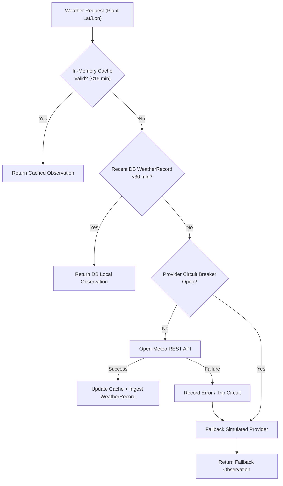

# SolarMind Weather Intelligence & Grid Interruption Detection

## 1. Overview & Core Invariants

Solar PV performance fluctuates due to both environmental atmospheric changes (clouds, rain, ambient temperature) and utility grid interruptions (feeder trips, voltage sags, power cuts). 

SolarMind provides:
1. **Weather Intelligence Service**: Multi-tier meteorological provider abstraction, live observation caching, circuit-breaker resilience, and cloud-versus-fault analytical separation.
2. **Grid Interruption Detection Service**: Automated evaluation of AC voltage collapse, grid frequency excursions, and daylight communication gaps to reconstruct defensible power-cut timelines and quantify lost solar yield.

### Key Invariants
- **Observation vs. Forecast Separation**: Forecasts are marked with `is_forecast: true` and are never treated as ground-truth observations (`is_forecast: false`).
- **Careful Outage Attribution**: Remote telemetry gaps during daytime are classified as `"AC supply interruption suspected"` rather than claiming physical switch/MCB states that cannot be verified remotely.
- **Circuit Breaker Protection**: External weather API outages trip a 5-minute cooldown after 3 consecutive errors, seamlessly falling back to cached or local station data without degrading system responsiveness.

---

## 2. Weather Intelligence Architecture

### 2.1 Provider Implementations
- **`OpenMeteoWeatherProvider`** ([`open_meteo.py`](file:///c:/Users/Lenovo/Desktop/Solar%20mind/backend/app/weather/open_meteo.py)): Fetches real-time temperature, cloud cover, global horizontal irradiance (GHI), and WMO weather codes.
- **`SimulatedWeatherProvider`** ([`simulated.py`](file:///c:/Users/Lenovo/Desktop/Solar%20mind/backend/app/weather/simulated.py)): Physics-informed celestial model providing offline fallback and deterministic testing.

---

## 3. Grid Interruption & Outage Event Pipeline

The outage detection service evaluates raw electrical telemetry across discrete time windows:

| Scenario | Trigger Condition | Status | Actionable Description |
| :--- | :--- | :--- | :--- |
| **Confirmed Grid Collapse** | $V_{\text{ac}} < 15\text{ V}$ or frequency collapse with $V_{\text{dc}} \ge 50\text{ V}$ energized | `CONFIRMED` | Grid voltage collapsed at inverter AC terminals while solar PV array remained energized. |
| **Severe Voltage Sag** | $15\text{ V} \le V_{\text{ac}} < 170\text{ V}$ | `SUSPECTED` | Grid voltage sag below inverter operational window. |
| **Frequency Trip** | $f_{\text{hz}} < 45\text{ Hz}$ or $f_{\text{hz}} > 55\text{ Hz}$ | `CONFIRMED` | Anti-islanding protection trip due to grid frequency excursion. |
| **Daylight Telemetry Gap** | Sampling gap $>60\text{ min}$ during daylight ($\alpha \ge 10^\circ$) | `SUSPECTED` | AC supply interruption suspected; data logger offline; physical MCB status cannot be confirmed remotely. |

### Lost Energy & Financial Deficit Formulation
$$\Delta E_{\text{lost}} = \int_{t_{\text{start}}}^{t_{\text{end}}} P_{\text{expected}}(t) \cdot \mathbb{I}(\text{sun is up}) \, dt \quad [\text{kWh}]$$
$$\text{Financial Loss (INR)} = \Delta E_{\text{lost}} \times \text{Tariff Rate}$$

---

## 4. REST API Reference

| Endpoint | Method | Description |
| :--- | :--- | :--- |
| `/api/v1/weather/plants/{plant_id}/current` | `GET` | Retrieve live weather observation with freshness seconds. |
| `/api/v1/weather/plants/{plant_id}/forecast` | `GET` | Retrieve multi-hour solar irradiance and weather forecast. |
| `/api/v1/weather/plants/{plant_id}/analyze-cloud` | `POST` | Assess whether yield deficit is weather-explained vs abnormal. |
| `/api/v1/weather/records` | `POST` | Ingest local weather station or pyranometer telemetry. |
| `/api/v1/outages` | `GET` | List filtered grid outage events. |
| `/api/v1/outages/{outage_id}` | `GET` | Get outage details, electrical evidence, and loss metrics. |
| `/api/v1/outages/detect` | `POST` | Trigger automated sliding-window outage detection over telemetry. |
| `/api/v1/outages/{outage_id}` | `PATCH` | Update or resolve outage event and record restoration time. |
