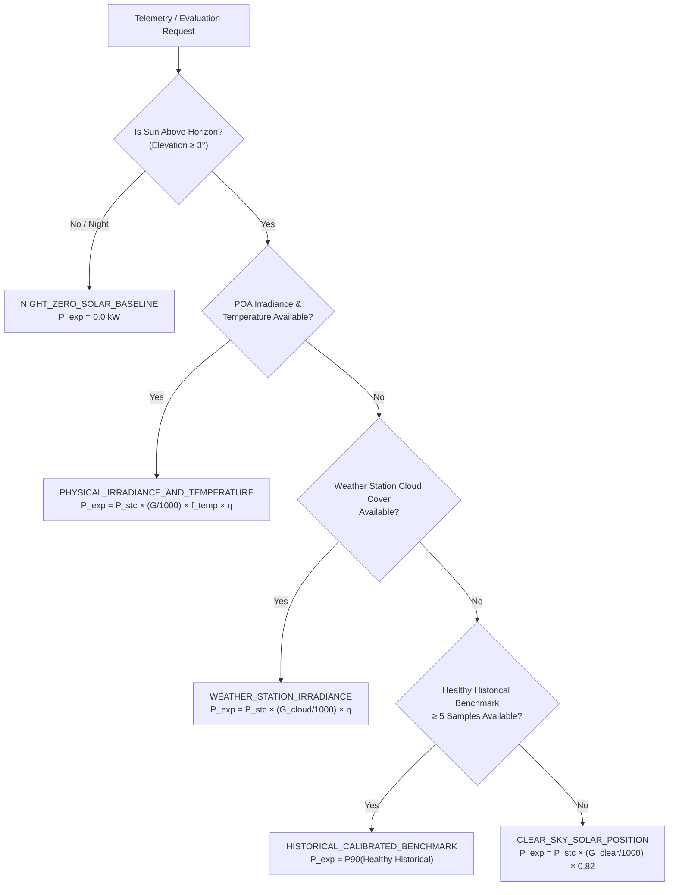

# SolarMind Expected-Generation Engine & Why-Low Diagnostic Workflow

## 1. Executive Summary & Philosophy

Solar PV systems experience performance shortfalls for a diverse spectrum of physical, environmental, and operational reasons. A common pitfall in solar monitoring tools is **false hardware accusation**—jumping to conclusions that an inverter or module is defective when the actual cause is merely nightfall, heavy cloud cover, utility grid loss, or missing sensor feeds.

SolarMind implements a deterministic, physics-informed **Expected-Generation Engine** coupled with a strict **10-Step Why-Low Diagnostic Pipeline**.

### Foundational Invariants
1. **Never Blame the Inverter Prematurely**: Low generation is never classified as an inverter fault without affirmative, factual electrical or alert evidence.
2. **Deterministic Precedence**: Natural solar absence (night / twilight) and weather attenuation are always ruled out before evaluating equipment health.
3. **No Arbitrary Universal Curves**: Expected power is calculated specifically for the plant's geographic location, solar geometry, installed capacity, ambient/cell temperature, and calibrated historical healthy baseline.
4. **Honest Insufficient Evidence**: If available sensors cannot conclusively differentiate between causes, the system reports `INSUFFICIENT_EVIDENCE_OR_UNKNOWN` with actionable sensor check recommendations.

---

## 2. Expected-Generation Engine Architecture

The engine estimates instantaneous active power expectation ($P_{\text{expected}}$ in kW) through four specialized baseline models, selected dynamically according to available sensor fidelity.



### 2.1 Solar Celestial Geometry Formulation
Given UTC timestamp $t$, geographic latitude $\phi$, and longitude $\lambda$:
1. **Fractional Year ($\gamma$)**:
   $$\gamma = \frac{2\pi}{365} \left(n - 1 + \frac{\text{hour} - 12}{24}\right)$$
   where $n \in [1, 365]$ is the day of the year.
2. **Solar Declination ($\delta$)**:
   $$\delta = 0.006918 - 0.399912\cos(\gamma) + 0.070257\sin(\gamma) - 0.006758\cos(2\gamma) + 0.000907\sin(2\gamma) - 0.002697\cos(3\gamma) + 0.00148\sin(3\gamma)$$
3. **Equation of Time ($\text{EoT}$)**:
   $$\text{EoT} = 229.18 \times [0.000075 + 0.001868\cos(\gamma) - 0.032077\sin(\gamma) - 0.014615\cos(2\gamma) - 0.040849\sin(2\gamma)]$$
4. **True Solar Time & Hour Angle ($\omega$)**:
   $$t_{\text{solar}} = \text{UTC} + \frac{\text{EoT} + 4\lambda}{60}, \quad \omega = 15^\circ \times (t_{\text{solar}} - 12)$$
5. **Solar Elevation Angle ($\alpha$)**:
   $$\sin(\alpha) = \sin(\phi)\sin(\delta) + \cos(\phi)\cos(\delta)\cos(\omega)$$
6. **Theoretical Clear-Sky Irradiance ($G_{\text{clear}}$)**:
   $$G_{\text{clear}} = G_0 \times \sin(\alpha) \times 0.7^{(\text{AM}^{0.678})} + 0.1 \times G_0 \times \sin(\alpha)$$
   where $\text{AM}$ is relative air mass and $G_0 = 1367 \times [1 + 0.033\cos(2\pi n / 365)]\text{ W/m}^2$.

### 2.2 Temperature Derating Formulation
Crystalline silicon PV panels lose output efficiency as module temperature rises above Standard Test Conditions ($25^\circ\text{C}$):
$$f_{\text{temp}} = 1.0 + \gamma_{\text{temp}} \times (T_{\text{cell}} - 25^\circ\text{C})$$
where $\gamma_{\text{temp}} = -0.0038\text{ / }^\circ\text{C}$ ($-0.38\%\text{ / }^\circ\text{C}$).

If cell temperature is not directly instrumented, it is estimated from ambient temperature:
$$T_{\text{cell}} = T_{\text{ambient}} + \left(\frac{G_{\text{POA}}}{800\text{ W/m}^2}\right) \times (\text{NOCT} - 20^\circ\text{C})$$
with nominal $\text{NOCT} = 45^\circ\text{C}$.

---

## 3. The 10-Step Why-Low Evaluation Pipeline

The evaluation pipeline processes hypotheses in strict hierarchical order:

| Step | Evaluation Stage | Trigger Conditions | Candidate Cause Output | Severity |
| :--- | :--- | :--- | :--- | :--- |
| **1** | **Data Quality & Freshness** | Missing telemetry, staleness $>2\text{h}$ during daytime, or `SUSPICIOUS` flags. | `DATA_QUALITY_OR_STALENESS` | `WARNING` |
| **2** | **Solar Position Check** | Solar elevation $\alpha < 5^\circ$ or night ($\alpha \le 0^\circ$) with $P_{\text{obs}} \approx 0$. | `NIGHT_TIME_OR_LOW_SUN` | `NORMAL` |
| **3** | **Weather & Cloud Cover** | $G_{\text{POA}} < 250\text{ W/m}^2$ or cloud cover $\ge 70\%$, with proportional power. | `WEATHER_RELATED_REDUCTION` | `LOW` |
| **4** | **Grid Outage Evidence** | $V_{\text{ac}} < 15\text{ V}$ or grid frequency collapse while $V_{\text{dc}} > 50\text{ V}$ energized. | `GRID_OUTAGE_OR_DISCONNECTION` | `CRITICAL` |
| **5** | **Inverter Protection Alerts** | Active critical alert on inverter (e.g. `GROUND_FAULT`, `ISOLATION_FAULT`). | `INVERTER_HARDWARE_ALERT` | `CRITICAL` |
| **6** | **Thermal Over-Temperature** | Inverter heatsink $T \ge 72^\circ\text{C}$ with output clipped/derated $\ge 15\%$. | `THERMAL_DERATING_OR_CLIPPING` | `HIGH` |
| **7** | **MPPT / String Imbalance** | Channel 1 current $>2\text{ A}$ while Channel 2 current $<0.3\text{ A}$ with $V_{\text{dc}} > 50\text{ V}$. | `MPPT_OR_STRING_DISCONNECTION` | `HIGH` |
| **8** | **Shading & Soiling** | High irradiance ($G > 500\text{ W/m}^2$), $15\text{--}55\%$ yield gap. Depressed $V \to$ Shading; Normal $V \to$ Soiling. | `PARTIAL_SHADING` / `SURFACE_SOILING` | `MEDIUM` |
| **9** | **Historical Benchmark** | Current generation $>30\%$ below plant's calibrated P90 healthy baseline. | `HISTORICAL_PERFORMANCE_DIVERGENCE` | `MEDIUM` |
| **10**| **Residual Evaluation** | Normal ($<15\%$ yield gap) $\to$ `NORMAL_OPERATION`; Ambiguous/Sparse $\to$ `INSUFFICIENT_EVIDENCE`. | `NORMAL_OPERATION` or `INSUFFICIENT_EVIDENCE_OR_UNKNOWN` | `NORMAL` / `LOW` |

---

## 4. Structured Diagnostic Response Format

Every invocation of `POST /api/v1/diagnoses/why-low` returns a deterministic response envelope:

```json
{
  "plant_id": 1,
  "inverter_id": "INV-101",
  "timestamp": "2026-10-09T12:00:00Z",
  "observed_power_kw": 0.0,
  "expected_power_kw": 8.15,
  "baseline_method": "PHYSICAL_IRRADIANCE_AND_TEMPERATURE",
  "yield_gap_kw": 8.15,
  "yield_gap_pct": 100.0,
  "candidate_cause": "GRID_OUTAGE_OR_DISCONNECTION",
  "candidate_cause_title": "Utility Grid Outage or AC Breaker Trip",
  "severity": "CRITICAL",
  "is_fault": true,
  "supporting_evidence": [
    "AC grid voltage collapsed to 0.0 V (threshold: <15 V).",
    "DC array voltage is present (385.4 V), proving solar PV strings are illuminated and energized."
  ],
  "contradictory_evidence": [],
  "confidence_score": 0.98,
  "rule_score": 0.98,
  "score_meaning": "AC electrical measurements confirm inverter cannot export power due to grid disconnection or tripped AC breaker.",
  "data_coverage": 1.0,
  "evaluation_step_reached": 4,
  "recommended_next_check": "Verify utility power supply, inspect main AC distribution breaker (MCB), and check AC isolator contactor.",
  "solar_position": {
    "solar_elevation_deg": 62.4,
    "solar_zenith_deg": 27.6,
    "solar_azimuth_deg": 182.1,
    "is_daylight": true,
    "clear_sky_irradiance_wm2": 920.5
  },
  "raw_measurements": {
    "v_ac_v": 0.0,
    "v_dc_v": 385.4,
    "p_ac_kw": 0.0
  }
}
```
